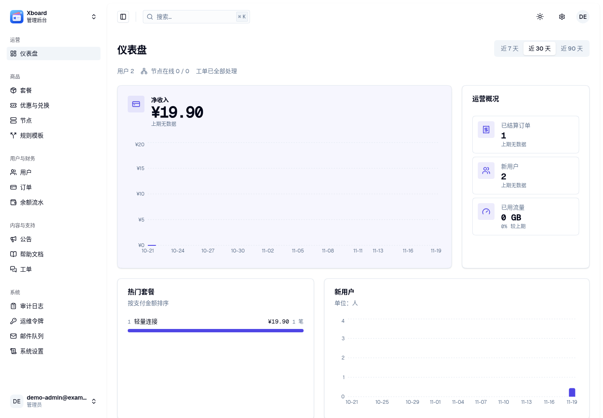

# Xboard TypeScript

[简体中文](README.md)

Xboard manages subscriptions, plans, nodes and customer accounts. It uses React, Express, Prisma and PostgreSQL. The admin console manages balance, offline and online payments, audit records, tickets, mail and promotions. Xboard includes Epay and Stripe, referral commissions and withdrawal review, Telegram notifications, human verification, and Chinese and English interfaces and email templates. The [operations API](docs/ops-api.md) lets administrators automate management with Bearer tokens.



## Start locally

Use Node.js 24, pnpm 11.0.3 and Docker with Compose v2, or a dedicated PostgreSQL 17 development database.

```bash
pnpm install
docker compose -f compose.typescript.yaml up -d
cp -n .env.example .env
pnpm db:setup
pnpm dev
```

The web app runs at <http://127.0.0.1:5173>, the admin console at `/admin`, and the development API reference at <http://127.0.0.1:3001/api/docs>. See [Architecture](ARCHITECTURE.md) for account provisioning and business rules.

## Deploy or upgrade

Point the panel domain at your server and follow the [Docker deployment guide](docs/typescript-deployment.md). Set the values in `ops/.env` using the example file and start Compose with `docker compose --env-file ops/.env -f compose.production.yaml up -d --build`. The [release guide](docs/releases.md) covers published images, upgrading, and database recovery.

On first launch, get the installation code from the API logs and create the administrator at `/setup`. Configure SMTP, alerts, and backups in the admin console.

The TypeScript edition uses a new database schema. Plan a separate migration for data from the PHP edition, keep a copy of the old database, and rotate node credentials when switching.

## Development

- [Architecture and business rules](ARCHITECTURE.md)
- [Node integration](docs/typescript-nodes.md)
- [Contributing](CONTRIBUTING.md)
- [Security reporting](SECURITY.md)
- [MIT license](LICENSE)

The frontend adapts [shadcn-admin](https://github.com/satnaing/shadcn-admin). Its license is in [apps/user/LICENSE.shadcn-admin](apps/user/LICENSE.shadcn-admin).
