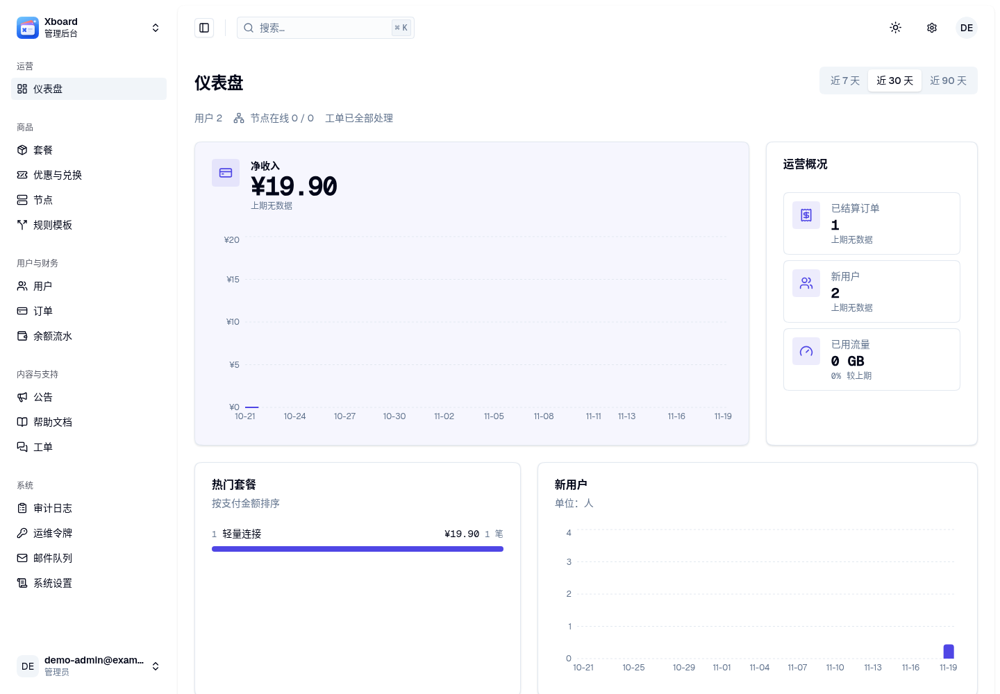

# Xboard TypeScript

[English](README.en.md)

独立的订阅管理系统，使用 React、Express、Prisma 和 PostgreSQL。
当前工作区仅保留新项目，旧 PHP 实现可通过 Git 历史查阅。

## 本地启动

需要 Node.js 22.12+（建议 24）、pnpm 11 和 PostgreSQL。

```bash
pnpm install
docker compose -f compose.typescript.yaml up -d
cp -n .env.example .env
pnpm db:setup
pnpm dev
```

`pnpm dev` 同时启动前后端；也可以分开启动：`pnpm api`（后端，端口 3001）和 `pnpm web`（前端，端口 5173，`/api` 转发到 3001）。后端启动前会自动重新生成 Prisma Client；拉到新的数据库迁移后仍需运行 `pnpm db:setup`。

已有根目录 `.env` 时请保留原配置。使用本机 PostgreSQL 时可跳过 Docker，
将 `DATABASE_URL` 指向该数据库。

- 用户端：http://127.0.0.1:5173
- 管理后台：http://127.0.0.1:5173/admin
- 开发 API 文档：http://127.0.0.1:3001/api/docs

## 功能

账户与邮件验证、套餐订单、余额支付、订阅生成、节点用量上报、公告工单、
管理员手动入账、套餐与节点管理、审计记录和邮件队列。
在线支付可启用易支付或 Stripe。支持邀请佣金、提现审核、Telegram 通知、三种人机验证和中英双语。节点支持 UniProxy 和 XrayR 旧 V2board 接口。



## 部署与升级

把面板域名指向服务器，按 [Docker 部署说明](docs/typescript-deployment.md) 填写 `ops/.env`，然后启动服务。

```bash
docker compose --env-file ops/.env -f compose.production.yaml up -d --build
```

首次启动后，从 API 日志获取安装码，在 `/setup` 创建管理员。SMTP、备份和告警可在后台配置。

前后端在同一个镜像里，Compose 只起应用和 PostgreSQL 两个容器。应用监听本机 `127.0.0.1:3001`，HTTPS 证书由你自己的反向代理（Nginx、Caddy、1Panel 等）负责，配置示例见部署说明。

也可以不在服务器上构建，在 `ops/.env` 写上 `XBOARD_IMAGE=ghcr.io/qunqin24/xboard:1.2.3`，直接使用 GHCR 上的发布镜像（amd64 和 arm64）。生产环境请固定到完整版本号，`edge` 跟随 `main`，只用于测试。

升级时先备份数据库和应用密钥，按 [发布与升级说明](docs/releases.md) 换到目标版本的镜像，执行前向迁移并核对业务数据。

发布新版本：在 `CHANGELOG.md` 写好版本条目，在 `main` 上打 `v1.2.3` 这样的标签并推送。GitHub Actions 会跑完整检查，推送多架构镜像，并创建 GitHub Release，详见 [发布与升级说明](docs/releases.md#发布新版本)。

## 目录与文档

| 路径 | 用途 |
| --- | --- |
| `apps/api` | API、数据库迁移及后端测试 |
| `apps/user` | 用户中心和管理后台，界面基于 [shadcn-admin](https://github.com/satnaing/shadcn-admin) |
| `packages/contracts` | 前后端共用的接口定义（zod），并由此生成 OpenAPI 文档 |
| `ops` | 生产环境变量示例 |
| [ARCHITECTURE.md](ARCHITECTURE.md) | 功能、业务规则、管理员初始化和开发说明 |
| [节点接入](docs/typescript-nodes.md) | 支持范围、配置及验证边界 |
| [部署说明](docs/typescript-deployment.md) | Docker、反向代理与 HTTPS、邮件与备份 |
| [运维 API](docs/ops-api.md) | 接入自动化管理 |
| [贡献指南](CONTRIBUTING.md) | 开发、测试与提交 |
| [安全报告](SECURITY.md) | 私下报告漏洞 |

```bash
pnpm api:generate
pnpm format:check
pnpm typecheck
pnpm test
pnpm build
```

每个 PR 和 `main` 上的提交都会在 GitHub Actions 里跑同样的检查，并试构建镜像。

真实节点、生产 SMTP 和公网 HTTPS 仍需在目标环境验收。

## 来源与许可证

以 [Xboard](https://github.com/cedar2025/Xboard) 为功能参考重写，
前端界面改编自 [shadcn-admin](https://github.com/satnaing/shadcn-admin)（MIT，
许可证见 `apps/user/LICENSE.shadcn-admin`）。
保留原仓库 Git 历史及 [MIT 许可证](LICENSE)。
TypeScript 版采用新的数据库结构。旧 PHP 站点的数据需要单独迁移，保留原数据库副本，并在切换时轮换节点密钥。
